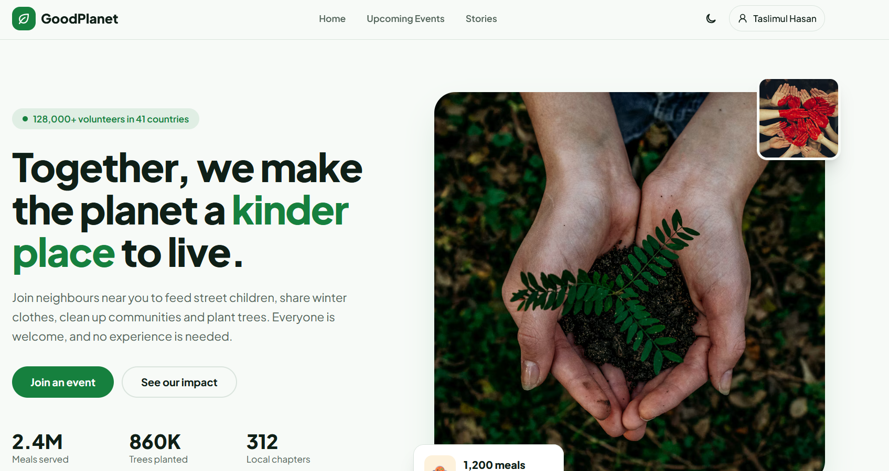

<div align="center">

# 🌍 GoodPlanet — Client

**Make a difference. Create a better planet.**

A community event platform that connects volunteers, organizers and neighbours around social and environmental causes. Discover events, join them, track your volunteer hours and build a profile, or organize your own.

[Links](#-links) · [Server repository](https://github.com/taslimul6/GoodPlanet-server) · [Report a bug](https://github.com/taslimul6/GoodPlanet/issues)


<br />



</div>

---

## 📑 Table of contents

1. [Links](#-links)
2. [About the project](#-about-the-project)
3. [Features](#-features)
4. [Tech stack](#-tech-stack)
5. [Pages and routes](#-pages-and-routes)
6. [API overview](#-api-overview)
7. [Project structure](#-project-structure)
8. [Getting started](#-getting-started)
9. [Environment variables](#-environment-variables)
10. [Security](#-security)
11. [Scripts](#-scripts)
12. [Roadmap](#-roadmap)

---

## 🔗 Links

| | |
| --- | --- |
| **Live website** | _add the client URL after deployment_ |
| **Live API** | _add the server URL after deployment_ |
| **Client repository** | https://github.com/taslimul6/GoodPlanet |
| **Server repository** | https://github.com/taslimul6/GoodPlanet-server |

---

## 🌱 About the project

GoodPlanet is built with the Next.js App Router. Every list, form and dashboard talks to a real Express + MongoDB API that is protected with JWTs.

| Who | What they can do |
| --- | --- |
| **Visitor** | Read the home page, see featured events, sign up or log in with email or Google. |
| **Participant** | Browse, search and filter events, save them, join or cancel, wait for a spot on full events, follow organizers, collect volunteer hours, manage a profile. |
| **Organizer** | Create, edit and delete events, set capacity and volunteer hours, see their events and stats on one dashboard. |

---

## ✨ Features

### Events
- **Browse and search** upcoming events with category filters and a live search box.
- **Event page** with banner, status badge, description, organizer, location and a sidebar of actions.
- **Create, edit and delete** your own events (delete asks for confirmation and also removes bookings, bookmarks and waitlist entries).
- **Status badges:** Upcoming, Ongoing today, Ended, plus **Full** or **N spots left** when seats run low.

### Joining
- **Capacity limit** with a progress bar. Two people joining the last seat at the same moment is handled safely: only one gets in.
- **Waitlist:** on a full event you can join the waitlist and see your position. A cancellation or a larger capacity moves people in automatically, oldest first.
- **Cancel join** with a confirmation dialog.

### Sharing and planning
- **Save / bookmark** events (heart-style toggle on cards and the event page) and review them on `/events/saved`.
- **Share** with copy link, WhatsApp, Facebook or the native share sheet.
- **Add to calendar:** Google Calendar link or downloadable `.ics` file.
- **Countdown timer** to the start of the event.

### Profile
- **Overview:** joined, upcoming, completed, created and saved counts.
- **Volunteer hours:** hours are credited automatically once a joined event has ended, with a log of every event. Organizers can set the hours per event (default 4).
- **Follow organizers** and manage the list from the Following tab.
- **Settings:** edit name and bio, **upload a profile photo** (ImgBB), change password, delete account.

### Dashboards
- **My Events** and **Joined Events** share one set of components: stats, status badges, empty and error states and loading skeletons.

### Auth and UI
- **Better Auth** with email + password and Google sign in; route protection in `proxy.ts`.
- Responsive layout, light / dark mode, toast notifications and loading skeletons.

---

## 🧰 Tech stack

| Area | Tools |
| --- | --- |
| Framework | **Next.js 16** (App Router, Cache Components, `proxy.ts`), **React 19**, **TypeScript** |
| Styling / UI | **Tailwind CSS 4**, **shadcn/ui** on **Base UI**, `lucide-react`, `tw-animate-css` |
| Auth | **Better Auth** (email, Google OAuth, JWT plugin) + `@better-auth/mongo-adapter` |
| Data | **MongoDB**, Express API for business data ([server repo](https://github.com/taslimul6/GoodPlanet-server)) |
| Images | **ImgBB** API (uploaded from the server, the key never reaches the browser) |
| UX | `sonner` toasts, `next-themes`, `embla-carousel-react`, `recharts`, `date-fns` |

---

## 🗺️ Pages and routes

| Type | Routes |
| --- | --- |
| Public | `/` Home, `/login`, `/signup` |
| Logged-in only | `/events` List, `/events/[id]` Details, `/events/add`, `/events/edit/[id]`, `/events/manage`, `/events/joined`, `/events/saved`, `/profile` |

Next.js route handlers: `/api/auth/[...all]` (Better Auth) and `/api/upload/avatar` (photo upload).

---

## 🔌 API overview

The client talks to the [GoodPlanet server](https://github.com/taslimul6/GoodPlanet-server) with `Authorization: Bearer <JWT>`. Endpoints marked 🔒 need a valid token.

| Area | Endpoints |
| --- | --- |
| Events | `GET /` · `GET /featured` · 🔒 `GET /event/:id` · 🔒 `POST /event` · 🔒 `PUT /event/:id` · 🔒 `DELETE /event/:id` · 🔒 `GET /myEvents` |
| Joining | 🔒 `POST /event/join` · 🔒 `DELETE /event/join/:eventId` · 🔒 `GET /booked/:id` · 🔒 `GET /bookedEvents` |
| Capacity | 🔒 `GET /event/capacity/:id` · 🔒 `POST /event/waitlist` · 🔒 `DELETE /event/waitlist/:eventId` |
| Saved | 🔒 `GET /saved` · 🔒 `GET /saved/ids` · 🔒 `POST /saved` · 🔒 `DELETE /saved/:eventId` |
| Profile | 🔒 `GET /profile/stats` |
| Follow | 🔒 `GET /following` · 🔒 `GET /follow/status/:organizer` · 🔒 `POST /follow` · 🔒 `DELETE /follow/:organizer` |

**Event document**

```json
{
  "title": "Cox's Bazar Beach Cleanup Drive",
  "category": "Environment",
  "organizer": "Clean Coast Bangladesh",
  "description": "…",
  "date": "2026-12-12",
  "location": "Cox's Bazar",
  "image": "https://…",
  "capacity": "250",
  "hours": "4",
  "email": "creator@example.com",
  "createdBy": "Creator name"
}
```

MongoDB collections: `events`, `bookedEvents`, `savedEvents`, `follows`, `waitlist` (business data) and the Better Auth collections (`user`, `session`, `account`, `verification`, `jwks`).

---

## 📁 Project structure

```
good-planet/
├── src/
│   ├── app/
│   │   ├── page.tsx              # Home page
│   │   ├── layout.tsx            # Root layout (navbar, footer, theme, toasts)
│   │   ├── events/               # list, [id], add, edit/[id], manage, joined, saved
│   │   ├── profile/              # Profile page with tabs
│   │   ├── login/ signup/
│   │   ├── api/                  # auth/[...all], upload/avatar
│   │   └── lib/                  # auth.ts (server), auth-client.ts (browser)
│   └── proxy.ts                  # Route protection
├── components/
│   ├── events/                   # EventCard, SaveBtn, ShareBtn, JoinBtn, StatusBadge, …
│   ├── profile/                  # Header and the Overview / Following / Settings tabs
│   ├── homePage/ shared/ ui/     # Home sections, navbar and footer, shadcn/ui
├── lib/                          # event types, date helpers, token helpers, server fetch
├── docs/                         # Feature plan, commit plan, screenshots
└── public/
```

---

## 🚀 Getting started

### Prerequisites
- **Node.js 20+** and npm
- A **MongoDB** database (Atlas works)
- The **[GoodPlanet server](https://github.com/taslimul6/GoodPlanet-server)** running (default `http://localhost:5000`)
- Accounts for **Google OAuth** and **ImgBB**

### Installation

```bash
git clone https://github.com/taslimul6/GoodPlanet.git
cd GoodPlanet
npm install
cp .env.example .env     # then fill in the values (see below)
```

### Run locally

```bash
# 1. start the API first (in the server folder)
node index.js            # http://localhost:5000

# 2. start the client
npm run dev              # http://localhost:3000
```

---

## 🔐 Environment variables

Create `.env` from `.env.example`. **Never commit `.env`.**

| Variable | Required | Description |
| --- | --- | --- |
| `BETTER_AUTH_SECRET` | ✅ | Secret that signs sessions |
| `BETTER_AUTH_URL` | ✅ | Public URL of the client (also the JWT issuer) |
| `NEXT_PUBLIC_BETTER_AUTH_URL` | ➖ | Same URL for the browser (recommended on Vercel) |
| `MONGODB_URI` | ✅ | MongoDB connection string |
| `GOOGLE_CLIENT_ID` | ✅ | Google OAuth client ID |
| `GOOGLE_CLIENT_SECRET` | ✅ | Google OAuth client secret |
| `NEXT_PUBLIC_MAIN_API` | ✅ | Base URL of the Express API, e.g. `http://localhost:5000` |
| `FEATURED_API` | ✅ | `{API}/featured`, used by the home page |
| `IMGBB_API_KEY` | ✅ | ImgBB key for profile photo uploads |

The server needs `MONGODB_URI` and `CLIENT_URL` (the client's public URL, used to fetch the JWKS that verifies tokens).

Google OAuth redirect URI: `{BETTER_AUTH_URL}/api/auth/callback/google`

---

## 🛡️ Security

- All secrets come from environment variables and `.env*` files are gitignored.
- Better Auth signs a short-lived JWT; the server verifies it against the client's JWKS. Newer endpoints read the user's email from the verified token, not from the request.
- Photo uploads go through a server route that checks the session, the file type (JPG, PNG, WEBP, GIF) and the size (5 MB) before sending to ImgBB.
- Deleting an account requires the password (or a fresh sign in for Google accounts) plus a typed confirmation, and removes the user's data.

---

## 📜 Scripts

| Command | What it does |
| --- | --- |
| `npm run dev` | Start the development server |
| `npm run build` | Production build |
| `npm run start` | Serve the production build |
| `npm run lint` | Run ESLint |
| `npx tsc --noEmit` | Type check |

---

## 🚧 Roadmap

Ideas planned in [docs/plans/features.md](docs/plans/features.md): map and directions, image gallery, event duplicate, recurring events, comments and reviews, email and in-app notifications, admin panel and role system, certificates, multi-language and PWA support.

---

<div align="center">

Released under the MIT License · Made with 🌱 by **Taslimul Hasan**

*Small actions can create a big impact.*

</div>
